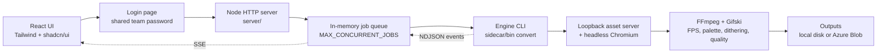

# Fallback Forge

Fallback Forge is a web app for converting HTML5 banner packages into quality-controlled GIF fallbacks. The interface is React + TypeScript, Tailwind CSS, and shadcn/ui. A Node server (Fastify) accepts uploads and runs the existing Playwright capture and FFmpeg/Gifski engine as one child process per job. It is deployed as a single container on Azure App Service. For now, sign-in is a shared team password (Okta is planned).

## Architecture



- Uploads (ZIPs, `.html` files, or folders) are unpacked into a per-job directory with path-traversal, symlink, size, and count checks.
- Each job runs `node sidecar/bin/banner-forge-sidecar.cjs convert` in its own process group, so cancelling or timing out stops Chromium, FFmpeg, and gifski too.
- Progress streams over Server-Sent Events, with heartbeats and `Last-Event-ID` replay. A page refresh reattaches to the running batch.
- The browser never sees server paths. Results carry download URLs, which serve local files or redirect to short-lived Blob SAS URLs.
- The ad never runs in the app's own page. The engine serves only that banner over an ephemeral loopback port and renders it in a separate headless Chromium process.

For the code map, runtime walkthrough, environment variables, Azure deployment, and troubleshooting, see [`docs/DEVELOPMENT.md`](docs/DEVELOPMENT.md). The migration from the earlier Tauri desktop app is described in [`docs/WEB_MIGRATION.md`](docs/WEB_MIGRATION.md) and tracked in [`docs/WEB_MIGRATION_STATUS.md`](docs/WEB_MIGRATION_STATUS.md).

## What it does

- Accepts banner ZIPs (one banner, or one per top-level folder with `index.html`), folders, and direct HTML entry files, by drag-and-drop or file pickers.
- Detects dimensions from `meta[name="ad.size"]` and common banner containers.
- Waits for images, fonts, and video metadata before capture.
- Detects Web Animations, GSAP 3, and legacy `window.tl` / TimelineMax duration.
- Captures at 24 FPS with a fixed viewport, device scale, locale, timezone, and seeded `Math.random`.
- Coalesces identical adjacent frames without losing their display time.
- Lets the user choose FPS independently: 4, 12, 15, or 24; 15 FPS is the default.
- Lets the user choose a separate palette ceiling: 64, 128, 192, or 256 colors; 256 is the default.
- Offers Adaptive, no dithering, Light Bayer, Bayer, and mild deband plus Light Bayer. Adaptive compares every method with VMAF/CAMBI and chooses the smallest candidate within 0.25 points of the best score.
- Applies bundled Gifski compression with a user-selected quality score from 1–100; 80 is the default and 100 disables the lossy LZW pass.
- Can generate the configured Forge GIF, a delivery-size-limited GIF, or both from the same captured frames.
- Optionally exports every captured source frame as PNG and/or JPEG ZIP archives. Each archive contains numbered frames plus a timing manifest; JPEG exports flatten transparency onto a selected matte color.
- In Auto loop mode, exports a finite narrative once even when decorative elements animate indefinitely.
- Produces a GIF and a detailed `.report.json` per output, each downloadable from the results table.
- Validates width, height, frame count, duration, loop behavior, and exact byte size.

The Forge output uses its selected settings unchanged. A size-limited delivery output preserves original dimensions and searches a bounded set of lower-cost FPS, palette, dithering, and Gifski-quality combinations to meet the selected decimal-KB limit. If no candidate fits, it writes the smallest candidate and marks it over target. If capture safety limits prevent the selected output rate, the sidecar uses the highest available rate without duplicating frames and reports the adjustment explicitly.

## Prerequisites

For local development:

- Node.js 22 or newer
- Rust and Cargo (builds the Gifski worker)
- A Chromium-family browser; Google Chrome is detected automatically on macOS
- FFmpeg on `PATH`, at a common system path, or via `BANNER_FORGE_FFMPEG`. Adaptive dithering needs a build with `libvmaf`.

For deployment, only Docker (or `az acr build`) is needed: the image bundles Chromium (Playwright base image), a pinned static FFmpeg with libvmaf, and the Gifski worker.

Licensing: Gifski is AGPL-3.0-or-later. Because it is offered over a network, the UI shows a "Source (AGPL)" link (`VITE_SOURCE_URL`), and the `gifski-worker` source must stay publicly available. The image ships a GPL FFmpeg build, so FFmpeg's GPL obligations apply; Chromium comes under its own licences.

## Set up

```bash
npm install
npm run sidecar:install
npm run gifski:build    # installs the worker at sidecar/bin/gifski-worker
npm run server          # API on :8080
npm run dev             # UI on :5173, proxies /api to :8080
```

Open http://localhost:5173, add banner ZIPs or folders, and choose **Forge GIFs**. Locally there's no sign-in unless you start the server with `ACCESS_PASSWORD='...'`; see [Authentication](docs/DEVELOPMENT.md#authentication).

To run the production image:

```bash
docker build -t fallback-forge --build-arg VITE_SOURCE_URL=https://github.com/<org>/gif-forge .
docker run --rm -p 8080:8080 fallback-forge
```

To deploy to Azure App Service, follow [`docs/AZURE_DEPLOYMENT.md`](docs/AZURE_DEPLOYMENT.md) (uses `infra/deploy.sh`).

## Commands

```bash
npm run dev             # Vite UI with /api proxy
npm run build           # TypeScript and Vite production build (dist/)
npm run server          # HTTP server: API, SSE, and dist/ with SPA fallback
npm run server:test     # Server tests (uploads, queue, cancel, SSE, auth)
npm run gifski:test     # Rust Gifski worker unit tests
npm run gifski:build    # Build and install the current-platform Rust worker
npm run sidecar:test    # Engine tests (builds the worker first)
npm run check           # build + gifski tests + sidecar tests + server tests
```

## Engine protocol

The server starts one engine process per job with a fixed `convert` argument and writes a single JSON request line to stdin. This avoids command-line length limits for large batches. The paths are server-side job directories; browsers only send a `config` object and files to `POST /api/jobs`:

```json
{
  "inputPaths": ["/absolute/path/to/banner-package"],
  "outputDirectory": "/absolute/path/to/output",
  "protocolVersion": 4,
  "config": {
    "outputFps": 15,
    "maxColors": 256,
    "dithering": "adaptive",
    "gifskiQuality": 80,
    "maxDurationSeconds": 30,
    "loopMode": "auto",
    "outputMode": "both",
    "maxBytes": 150000,
    "frameExport": "both",
    "jpegQuality": 90,
    "jpegBackground": "#ffffff"
  }
}
```

Standard output is newline-delimited JSON with `progress`, `result`, `error`, and `complete` events. The server relays them over SSE, replacing `outputPath`/`reportPath` with `fileName`, `downloadUrl`, and `reportUrl`, and `inputPath` with the banner's display name. Standard error is reserved for diagnostics. Each input is isolated: one failed package is reported without discarding successful outputs from the rest of the batch.

Protocol v4 rejects former presets, editable capture-FPS fields, and Gifsicle compression modes. `outputMode` is `forge`, `size-limited`, or `both`; `maxBytes` is the delivery target in bytes. A delivery result also exposes its target, whether it was met, and the number of candidates tested. The UI displays sizes in decimal KB.

`frameExport` is `none`, `png`, `jpeg`, or `both`. Frame archives use the original captured PNG sequence before GIF coalescing, preserving the capture timeline and dimensions. Each ZIP includes `manifest.json` with ordered filenames, timestamps, duration, dimensions, and effective capture FPS. JPEG output uses `jpegQuality` (1–100) and flattens transparent pixels onto `jpegBackground` (`#rrggbb`).

The dithering choices trade size against gradient quality:

- None is usually smallest and crispest for flat artwork, but can band gradients.
- Light Bayer adds subtle texture and is the recommended manual balance.
- Bayer smooths gradients more strongly but tends to be larger and more visibly patterned.
- Deband + Light Bayer smooths gradients most aggressively, can soften detail, and is usually largest.
- Adaptive is slowest because it measures all four concrete methods before choosing.

Gifski quality is an integer from 1–100. It is a perceptual quality score, not a promised percentage reduction or target file size: lower values allow more compression artifacts, while higher values preserve more detail. The default is 80. A value of 100 disables Gifski's lossy LZW pass while retaining its re-encoding and frame optimization.

## Tool discovery

The engine checks explicit environment variables, sibling locations (next to the CLI and in `bin/`), common absolute paths, and finally `PATH`. The container sets all three explicitly, and `GET /healthz` reports whether each one resolves.

- `BANNER_FORGE_CHROMIUM`
- `BANNER_FORGE_FFMPEG`
- `BANNER_FORGE_GIFSKI_WORKER`
- `BANNER_FORGE_CHROMIUM_NO_SANDBOX=1` adds `--no-sandbox` on hosts that don't allow Chromium's sandbox

## Known limits

- JavaScript driven by custom `requestAnimationFrame` loops, WebGL, canvas randomness, or live network data may not be deterministically seekable.
- Remote fonts/scripts require network access and can make rendering less reproducible. Production jobs should vendor all assets.
- GIF has a 256-color ceiling and 10 ms timing granularity. Rates such as 12, 15, and 24 FPS therefore use alternating frame delays while preserving total duration as closely as possible.
- High-FPS, large-palette photo animation can produce multi-megabyte GIFs. The delivery search may still miss a strict target; it keeps dimensions fixed and reports the smallest candidate rather than silently discarding the output.
- Adaptive quality scoring requires an FFmpeg build with `libvmaf` and CAMBI. Without it, the encoder uses Light Bayer and records a warning. The same fallback happens for very small banners, because libvmaf's CAMBI feature fails on tiny frames (120×60 and 128×64 failed in testing; 728×90, 300×250 and 160×600 work).
- Cancellation and timeouts kill the job's whole process group. There are per-job limits (upload size, extracted size, file count, banner count, runtime) but no per-user quotas yet.
- Jobs live in memory: run **one instance**. A restart forgets queued and running jobs; Blob outputs remain until the 7-day lifecycle rule deletes them.

## Scaling beyond one instance

The job store and queue are in memory, so the app must run as a single instance today. To scale out, move jobs and events to Azure Queue/Table storage (or similar), run engine workers that consume the queue, and keep the same NDJSON engine contract and SSE API.
