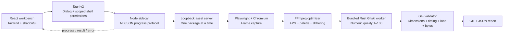

# Fallback Forge

Fallback Forge is a Tauri v2 desktop workbench for converting HTML5 banner packages into quality-controlled GIF fallbacks. The interface is React + TypeScript, Tailwind CSS, and shadcn/ui. A bundled Node executable runs the Playwright capture and FFmpeg optimization pipeline outside the privileged Tauri webview.

## Architecture



The ad never runs inside the application webview. The sidecar serves only the selected package over an ephemeral loopback port and renders it in a separate headless Chromium process.

For a contributor-oriented code map, runtime walkthrough, protocol contract, and troubleshooting guide, see [`docs/DEVELOPMENT.md`](docs/DEVELOPMENT.md). For the planned move from desktop app to hosted web app on Azure App Service, see [`docs/WEB_MIGRATION.md`](docs/WEB_MIGRATION.md).

## What it does

- Lets the desktop user select multiple package folders; the sidecar API also accepts direct HTML entry files.
- Detects dimensions from `meta[name="ad.size"]` and common banner containers.
- Waits for images, fonts, and video metadata before capture.
- Detects Web Animations, GSAP 3, and legacy `window.tl` / TimelineMax duration.
- Captures at 24 FPS with a fixed viewport, device scale, locale, timezone, and seeded `Math.random`.
- Coalesces identical adjacent frames without losing their display time.
- Lets the user choose FPS independently: 4, 12, 15, or 24; 15 FPS is the default.
- Lets the user choose a separate palette ceiling: 64, 128, 192, or 256 colors; 256 is the default.
- Offers Adaptive, no dithering, Light Bayer, Bayer, and mild deband plus Light Bayer. Adaptive compares every method with VMAF/CAMBI and chooses the smallest candidate within 0.25 points of the best score.
- Applies bundled Gifski compression with a user-selected quality score from 1–100; 80 is the default and 100 disables the lossy LZW pass.
- Can generate the configured Forge GIF, a delivery-size-limited GIF, or both from the same captured frames.
- Optionally exports every captured source frame as PNG and/or JPEG ZIP archives. Each archive contains numbered frames plus a timing manifest; JPEG exports flatten transparency onto a selected matte color.
- In Auto loop mode, exports a finite narrative once even when decorative elements animate indefinitely.
- Writes a GIF and a detailed `.report.json` beside it.
- Validates width, height, frame count, duration, loop behavior, and exact byte size.

The Forge output uses its selected settings unchanged. A size-limited delivery output preserves original dimensions and searches a bounded set of lower-cost FPS, palette, dithering, and Gifski-quality combinations to meet the selected decimal-KB limit. If no candidate fits, it writes the smallest candidate and marks it over target. If capture safety limits prevent the selected output rate, the sidecar uses the highest available rate without duplicating frames and reports the adjustment explicitly.

## Prerequisites

- Node.js 22 or newer
- Rust and Cargo
- A Chromium-family browser; Google Chrome is detected automatically on macOS
- FFmpeg available beside the sidecar, at a common system path, or through `BANNER_FORGE_FFMPEG`
- No separate Gifsicle installation is required; the pinned Rust Gifski worker is built and bundled with the app

For commercial distribution, provide a reviewed FFmpeg build and comply with its configured LGPL/GPL terms. Gifski is AGPL-3.0-or-later, so distributing the bundled worker requires licensing review and the applicable source/distribution obligations; commercial licensing is available from its author. Chromium and FFmpeg are not embedded by this proof of concept because they materially increase installer size and require their own update/licensing process.

## Set up

```bash
npm install
npm run sidecar:install
npm run sidecar:build
npm run tauri:dev
```

`sidecar:build` creates the Node executable, builds the Rust Gifski worker, and copies both to the platform filenames Tauri requires, for example:

```text
src-tauri/binaries/banner-forge-sidecar-aarch64-apple-darwin
src-tauri/binaries/gifski-worker-aarch64-apple-darwin
```

When Tauri invokes the build hook, the sidecar builder uses `TAURI_ENV_TARGET_TRIPLE`, so `tauri build --target ...` packages and names the matching Node executable. Direct sidecar builds use the local Rust host triple. `BANNER_FORGE_RUST_TARGET` and `BANNER_FORGE_PKG_TARGET` remain available for explicit CI overrides. Build and test on each target operating system and architecture; universal macOS sidecars are not generated by this proof of concept.

Inputs are package folders containing `index.html` or direct `.html`/`.htm` files. Outputs are written to the selected directory as a GIF plus a matching `.report.json`; existing output names are preserved by adding a numeric suffix.

## Commands

```bash
npm run dev             # Browser-only UI development
npm run build           # TypeScript and Vite production build
npm run gifski:test     # Rust Gifski worker unit tests
npm run gifski:build    # Build and install the current-platform Rust worker
npm run sidecar:test    # Node unit tests
npm run sidecar:build   # Package and install the current-platform sidecar
npm run check           # Frontend build, sidecar tests/package, and cargo check
npm run tauri:dev       # Build the sidecar, then launch the desktop app
npm run tauri:build     # Build the sidecar, then create desktop bundles
```

## Sidecar protocol

The frontend starts one bounded sidecar process with a fixed `convert` argument and writes a single JSON request line to stdin. This avoids command-line length limits for large batches:

```json
{
  "inputPaths": ["/absolute/path/to/banner-package"],
  "outputDirectory": "/absolute/path/to/output",
  "protocolVersion": 4,
  "config": {
    "outputFps": 15,
    "maxColors": 256,
    "dithering": "adaptive",
    "gifskiQuality": 80,
    "maxDurationSeconds": 30,
    "loopMode": "auto",
    "outputMode": "both",
    "maxBytes": 150000,
    "frameExport": "both",
    "jpegQuality": 90,
    "jpegBackground": "#ffffff"
  }
}
```

Standard output is newline-delimited JSON with `progress`, `result`, `error`, and `complete` events. Standard error is reserved for diagnostics. Each input is isolated: one failed package is reported without discarding successful outputs from the rest of the batch.

Protocol v4 rejects former presets, editable capture-FPS fields, and Gifsicle compression modes. `outputMode` is `forge`, `size-limited`, or `both`; `maxBytes` is the delivery target in bytes. A delivery result also exposes its target, whether it was met, and the number of candidates tested. The desktop UI displays sizes in decimal KB.

`frameExport` is `none`, `png`, `jpeg`, or `both`. Frame archives use the original captured PNG sequence before GIF coalescing, preserving the capture timeline and dimensions. Each ZIP includes `manifest.json` with ordered filenames, timestamps, duration, dimensions, and effective capture FPS. JPEG output uses `jpegQuality` (1–100) and flattens transparent pixels onto `jpegBackground` (`#rrggbb`).

The dithering choices trade size against gradient quality:

- None is usually smallest and crispest for flat artwork, but can band gradients.
- Light Bayer adds subtle texture and is the recommended manual balance.
- Bayer smooths gradients more strongly but tends to be larger and more visibly patterned.
- Deband + Light Bayer smooths gradients most aggressively, can soften detail, and is usually largest.
- Adaptive is slowest because it measures all four concrete methods before choosing.

Gifski quality is an integer from 1–100. It is a perceptual quality score, not a promised percentage reduction or target file size: lower values allow more compression artifacts, while higher values preserve more detail. The default is 80. A value of 100 disables Gifski's lossy LZW pass while retaining its re-encoding and frame optimization.

## Tool discovery

The sidecar checks explicit environment variables, packaged sibling locations, common absolute paths, and finally `PATH`.

- `BANNER_FORGE_CHROMIUM`
- `BANNER_FORGE_FFMPEG`
- `BANNER_FORGE_GIFSKI_WORKER` (development/diagnostic override for the bundled worker)

This is important in desktop apps because spawned processes often receive a smaller environment than an interactive terminal.

## Known limits

- JavaScript driven by custom `requestAnimationFrame` loops, WebGL, canvas randomness, or live network data may not be deterministically seekable.
- Remote fonts/scripts require network access and can make rendering less reproducible. Production jobs should vendor all assets.
- GIF has a 256-color ceiling and 10 ms timing granularity. Rates such as 12, 15, and 24 FPS therefore use alternating frame delays while preserving total duration as closely as possible.
- High-FPS, large-palette photo animation can produce multi-megabyte GIFs. The delivery search may still miss a strict target; it keeps dimensions fixed and reports the smallest candidate rather than silently discarding the output.
- Adaptive quality scoring requires an FFmpeg build with `libvmaf` and CAMBI. Without it, the encoder uses Light Bayer and records a warning.
- Cancellation stops the sidecar process. Process-tree supervision and resource quotas should be added before operating an untrusted multi-tenant service.

## Scaling beyond desktop

The same NDJSON request/result contract can back a queue worker. Store uploads in object storage, enqueue one job per banner, use isolated Chromium worker pools, cap CPU/memory/runtime, cache captured frames across optimization attempts, and publish the GIF/report atomically. Horizontal scaling is then driven by queue depth without changing the desktop workflow.
