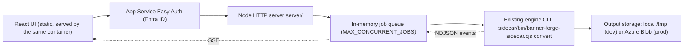

# Web migration guide (Tauri → Azure App Service)

> A guide for Claude Code. Work through the phases in order. Each phase ends with **Done when** checks. Don't start the next phase until they pass. Keep to the existing code style: CommonJS `.cjs` for Node code, `node:test` for tests, React + shadcn/ui for the UI.

## 1. Target architecture



Key principles:
- **Keep the engine unchanged.** `sidecar/lib/*` (`convert.cjs`, `capture.cjs`, `encode.cjs`, `frames.cjs`, `gif.cjs`, `helpers.cjs`, `tools.cjs`) and `gifski-worker/` stay as they are, apart from the small edits listed in Phase 1.
- **Run each job as a child process** of the existing CLI (`node sidecar/bin/banner-forge-sidecar.cjs convert`). The request goes in on stdin. This keeps the NDJSON protocol (v4), isolates crashes, and lets cancel kill the job's whole process tree (Chromium, FFmpeg, gifski).
- **The browser never sees server file paths.** The server replaces `outputPath`/`reportPath` in `result` events with download URLs.
- **Assume about 230 s HTTP idle timeout.** Jobs run in the background. Progress goes over SSE with heartbeats and can be replayed from `Last-Event-ID`.

## 2. Repository layout after migration

```
server/                 NEW  Node HTTP server (CommonJS)
  index.cjs             entry: config, routes, static UI, startup
  config.cjs            env parsing + defaults
  jobs.cjs              job store, queue, child-process runner, event buffer
  uploads.cjs           multipart parsing, ZIP extraction, folder reassembly, limits
  storage.cjs           local + Azure Blob output backends
  auth.cjs              Easy Auth principal → owner id
  test/*.test.cjs       node:test suites
sidecar/                KEPT engine (pkg packaging removed)
gifski-worker/          KEPT
src/                    React UI (Tauri imports removed)
Dockerfile              NEW  multi-stage image
.dockerignore           NEW
src-tauri/              DELETED
scripts/build-sidecar.mjs  DELETED
```

## 3. Phases

### Phase 0: Baseline
- Run `npm run build`, `npm run sidecar:test` and `npm run gifski:test`. Record the results so later regressions are obvious.
- Create the branch `web-migration`.

**Done when:** the baseline commands pass, or any existing failures are written down.

### Phase 1: Prepare the engine for headless Linux
Small, targeted edits only:
1. In `scripts/build-gifski-worker.mjs`, make the install target configurable. It currently copies into `src-tauri/binaries` (line ~10). Write to `bin/gifski-worker` by default, and still honour `BANNER_FORGE_GIFSKI_WORKER` at runtime. (`resolveExecutable` in `sidecar/lib/tools.cjs` already checks that variable first.)
2. In `sidecar/lib/capture.cjs` (`captureFrames`, ~line 291), add `--no-sandbox` to the Chromium launch args **only** when `BANNER_FORGE_CHROMIUM_NO_SANDBOX=1`. Comment that this is for container hosts that don't allow Chromium's sandbox.
3. In `sidecar/lib/tools.cjs` `packagedSiblingCandidates`, drop the `src-tauri/binaries` candidate.
4. In `sidecar/package.json`, remove the `pkg` block, the `@yao-pkg/pkg` dev dependency and the `build` script. Update the `pretest` path if needed.

**Done when:** `npm run sidecar:test` passes, and `echo '<request json>' | node sidecar/bin/banner-forge-sidecar.cjs convert` converts `sidecar/test/fixtures/package` into a temp directory.

### Phase 2: HTTP server (`server/`)
Dependencies (add to the root `package.json`): `fastify`, `@fastify/multipart`, `@fastify/static`, `yauzl` (ZIP reading), `@azure/storage-blob`. Nothing else.

**API**

| Method | Path | Purpose |
|---|---|---|
| `POST` | `/api/jobs` | multipart: `config` (JSON string, ConversionConfig) + files. Returns `{ jobId }` with status 202. |
| `GET` | `/api/jobs/:id/events` | SSE stream of protocol events. Replays buffered events and honours `Last-Event-ID`. Sends a `: ping` comment every 20 s. |
| `GET` | `/api/jobs/:id` | Job snapshot: `status`, `events`, `results` (for reconnecting or a page refresh). |
| `DELETE` | `/api/jobs/:id` | Cancel. Kills the process group. |
| `GET` | `/api/jobs/:id/files/:name` | Download an output (local storage), or redirect to a Blob SAS URL. |
| `GET` | `/healthz` | 200 if `ffmpeg`, Chromium and `gifski-worker` resolve (reuse `toolAvailable` / `resolveExecutable` / `resolveChromiumExecutable` from `sidecar/lib/tools.cjs`). |
| `GET` | `/*` | Static `dist/` with SPA fallback. |

**Uploads (`uploads.cjs`)**
- Each job gets a working directory: `${WORK_ROOT}/<jobId>/{input,output}`, where `WORK_ROOT` defaults to `/tmp/forge`.
- **Folder uploads:** the client sends each file with a `paths[]` field holding its `webkitRelativePath`. Rebuild the folders on the server. Each top-level folder is one banner.
- **ZIP uploads:** extract each ZIP into its own folder. If the ZIP has `index.html` at its root, it is one banner. Otherwise, each top-level folder that contains `index.html` is one banner.
- **Direct `.html` files** are allowed and handled the same way as by `resolveInputPath` in `sidecar/lib/helpers.cjs`.
- **Safety:**
  - reject path traversal and absolute paths (reuse `isWithin` from `sidecar/lib/server.cjs`)
  - skip symlinks
  - enforce `MAX_UPLOAD_BYTES` (default 100 MB), `MAX_UNZIPPED_BYTES` (default 300 MB), `MAX_FILES` (default 5000) and `MAX_BANNERS_PER_JOB` (default 25)
  - ignore `__MACOSX/` and `.DS_Store`
- The result is a list of absolute input paths to put in the engine request.

**Jobs (`jobs.cjs`)**
- In-memory `Map<jobId, Job>`, a FIFO queue, and `MAX_CONCURRENT_JOBS` (default 2).
- **Runner:**
  - `spawn(process.execPath, [sidecarBin, 'convert'], { detached: true, stdio: ['pipe','pipe','pipe'] })`
  - write one JSON line: `{ protocolVersion: 4, inputPaths, outputDirectory, config }`
  - parse stdout as NDJSON (same buffering logic as `parseLines` in `src/hooks/use-conversion.ts`)
- **Event rewriting:** on `result`, upload or register the files from `outputPath`/`reportPath`. Replace them with `downloadUrl`/`reportUrl` plus `fileName`, and remove the absolute paths. On `progress`/`error`, replace `inputPath` with the banner's display name.
- **Limits and cleanup:**
  - `JOB_TIMEOUT_MS` (default 15 min) → kill with `process.kill(-pid, 'SIGKILL')`
  - cancel uses the same kill
  - delete the input directory when the job ends
  - delete the job and its output directory after `JOB_TTL_MS` (default 24 h)
- **Ownership:** jobs record `owner` from `auth.cjs`. Every `/api/jobs/:id*` route returns 404 if the owner doesn't match.

**Auth (`auth.cjs`)**
- In production, read `X-MS-CLIENT-PRINCIPAL-ID` (set by Easy Auth). If `REQUIRE_AUTH=1` and the header is missing, return 401.
- In development (`REQUIRE_AUTH` unset), the owner is `"local"`.

**Storage (`storage.cjs`)**
- `STORAGE=local` (default): files stay in the job's output directory and are streamed by the download route with `Content-Disposition: attachment`.
- `STORAGE=blob`: upload to container `AZURE_STORAGE_CONTAINER` under `<owner>/<jobId>/<fileName>`, using `AZURE_STORAGE_CONNECTION_STRING`, or managed identity via `DefaultAzureCredential` if you add `@azure/identity`. The download route issues a 302 to a read-only SAS URL that expires in 1 h. Rely on a Blob lifecycle rule (7 days) for cleanup.

**Security headers:** set a CSP equivalent to the one in `src-tauri/tauri.conf.json`, without the `ipc:`/`asset:` schemes (`default-src 'self'; img-src 'self' data: blob: https://*.blob.core.windows.net; style-src 'self' 'unsafe-inline'; font-src 'self' data:; object-src 'none'; frame-ancestors 'none'`). Also set `X-Content-Type-Options: nosniff`.

**Scripts:** `"server": "node server/index.cjs"`, `"server:test": "node --test server/test/*.test.cjs"`. Bind to `PORT` (default 8080).

**Done when:** `npm run server:test` passes, covering:
- ZIP-slip rejection
- size and count limits
- ZIP and folder → banner discovery
- the queue respecting concurrency
- cancel killing the child
- SSE replay from `Last-Event-ID`
- owner isolation

Also, `curl -F config=... -F files=@fixture.zip localhost:8080/api/jobs`, followed by the SSE stream, ends in a `complete` event, and the download URLs return GIFs.

### Phase 3: Frontend
1. **Types (`src/types/conversion.ts`):**
   - remove `ConversionRequest.inputPaths`/`outputDirectory`
   - add `UploadItem { id, name, kind: 'zip' | 'folder' | 'html', files: File[], paths: string[], bytes }`
   - add `downloadUrl?`, `reportUrl?` and `fileName?` to `ResultEvent`
2. **Replace `src/components/path-panel.tsx` with `upload-panel.tsx`:**
   - a drop zone plus two buttons: "Add ZIPs" (`accept=".zip,.html,.htm"`, multiple) and "Add folders" (`webkitdirectory`)
   - group folder files by their top-level folder into one `UploadItem` each
   - keep the queued list UI, its remove buttons and its styling classes
   - remove the output-folder section completely
3. **Rewrite `src/hooks/use-conversion.ts`** without changing its public API (`{ job, run, cancel }`) or the `applyEvent` / progress-mapping functions:
   - `run(items, config)`: build the `FormData`, POST with `XMLHttpRequest` so upload progress can be shown as `"Uploading… n%"` (`phase: 'running'`), then open an `EventSource` to `/api/jobs/:id/events`
   - on `complete`, or a fatal error, close the `EventSource`
   - `cancel()`: `DELETE /api/jobs/:id`, then close the stream
   - keep the run-ID / cancelled-run guards
   - store the `jobId` in `sessionStorage`. On mount, if one exists, `GET /api/jobs/:id` and reattach, so a page refresh doesn't lose a running batch
4. **`src/App.tsx`:** remove the `outputFolder` state and its readiness branches. `ready` = there are upload items and the config is valid. Rename the "Folder access failed" alert to an upload error.
5. **`src/components/results-panel.tsx`:** add a download link per result (`downloadUrl`, and `reportUrl` as a secondary link). Display `fileName` instead of the basename of `outputPath`.
6. **`vite.config.ts`:** add `server.proxy['/api'] = 'http://localhost:8080'`. Remove any Tauri-specific settings (port 1420 strictness, `TAURI_*` env handling).
7. **Footer or app header:** add a "Source (AGPL)" link to the public `gifski-worker` source. Read it from `VITE_SOURCE_URL`. This is needed to comply with Gifski's AGPL on a network service.

**Done when:** `npm run build` passes, and with `npm run server` and `npm run dev` both running, a ZIP and a folder upload each produce downloadable GIFs in the browser. Cancel stops the job, and a refresh during a job reattaches to it.

### Phase 4: Remove Tauri
- Delete `src-tauri/`, `scripts/build-sidecar.mjs`, `public/tauri.svg` and `.vscode` Tauri recommendations.
- In `package.json`:
  - remove `@tauri-apps/api`, `@tauri-apps/plugin-dialog`, `@tauri-apps/plugin-shell`, `@tauri-apps/cli` and `@yao-pkg/pkg`
  - remove the `tauri*` and `sidecar:build` scripts
  - change `check` to `npm run build && npm run gifski:test && npm run sidecar:test && npm run server:test`
- Run `grep -ri tauri src server sidecar scripts`. It should find nothing.

**Done when:** `npm install && npm run check` passes and the grep is empty.

### Phase 5: Container image (`Dockerfile`)
Multi-stage build:
1. **`rust:1-bookworm` stage:** `cargo build --release --manifest-path gifski-worker/Cargo.toml`.
2. **`node:22-bookworm-slim` stage:** `npm ci`, `npm --prefix sidecar ci --omit=dev`, `npm run build` (produces `dist/`).
3. **Runtime stage, `mcr.microsoft.com/playwright:v1.62.1-noble`:**
   - Pin this version to the installed `playwright-core` in `sidecar/package-lock.json`, currently 1.62.1. Also pin the `playwright-core` dependency to an exact version so they can't drift.
   - Install FFmpeg **with libvmaf/CAMBI**. Check with `ffmpeg -hide_banner -filters | grep -E 'libvmaf'` during the build. If the distro package lacks it, use a pinned static GPL build that includes libvmaf (for example a BtbN release tarball, with its checksum verified).
   - Copy `/usr/local/bin/gifski-worker`, `dist/`, `server/`, `sidecar/` and the production `node_modules`.
   - Set the environment:
     - `BANNER_FORGE_FFMPEG=/usr/bin/ffmpeg` (or the static path)
     - `BANNER_FORGE_GIFSKI_WORKER=/usr/local/bin/gifski-worker`
     - `BANNER_FORGE_CHROMIUM` = the Chromium path in the Playwright image
     - `PORT=8080`
     - `NODE_ENV=production`
   - `USER pwuser`, `EXPOSE 8080`, `CMD ["node","server/index.cjs"]`.

Add a `.dockerignore` for `node_modules`, `target`, `dist`, `.git` and `sidecar/node_modules`.

**Done when:** `docker build -t fallback-forge .` succeeds, then `docker run -p 8080:8080 fallback-forge`. `/healthz` returns 200 and an end-to-end ZIP upload works. Test once **without** `BANNER_FORGE_CHROMIUM_NO_SANDBOX` to see whether the sandbox works locally.

### Phase 6: Azure deployment
Write this up as a new section in `docs/DEVELOPMENT.md`, plus an optional `infra/` script (Azure CLI). Never commit secrets.
1. **Resource group** + **Azure Container Registry (Basic)**: `az acr build -t fallback-forge:<git-sha> .`
2. **App Service plan:** Linux **B3**. The **Web App** uses the ACR image and pulls it with managed identity (the `AcrPull` role).
3. **App settings:**
   - `WEBSITES_PORT=8080`
   - `REQUIRE_AUTH=1`
   - `STORAGE=blob`
   - `AZURE_STORAGE_CONTAINER=outputs`
   - `MAX_CONCURRENT_JOBS=2`
   - `BANNER_FORGE_CHROMIUM_NO_SANDBOX=1` **only if** health or capture fails with sandbox errors
   - `VITE_SOURCE_URL` goes in at build time, as a build arg
4. **General settings:** Always On enabled; health check path `/healthz`; HTTPS only; minimum TLS 1.2.
5. **Authentication:** add Microsoft (Entra ID) as the identity provider, require sign-in, and return 302 for unauthenticated requests.
6. **Storage account:** private container `outputs`; lifecycle rule to delete blobs older than 7 days; give the web app's managed identity `Storage Blob Data Contributor`. To create SAS URLs with managed identity, use a user delegation key, which also needs `Storage Blob Delegator`.
7. **Logs:** turn on App Service logs and container logs, and optionally Application Insights.

**Done when:** a signed-in user can upload a ZIP on the `*.azurewebsites.net` URL, watch progress for a batch longer than 4 minutes without the connection dropping, and download the GIF and report. A user who isn't signed in is redirected to the sign-in page.

### Phase 7: Documentation
- Rewrite the `README.md` architecture, setup and commands sections for the web app, and keep the engine, protocol and dithering sections.
- Update `docs/DEVELOPMENT.md`: code map (server/), runtime walkthrough (upload → job → SSE → download), environment variable reference (table of every env var above with its default), troubleshooting (Chromium sandbox, missing libvmaf, 230 s timeout).
- Licensing note: Gifski is AGPL, so the source link in the UI and a public `gifski-worker` repository must stay in place. FFmpeg's GPL/LGPL obligations also apply.

## 4. Environment variable reference

| Variable | Default | Purpose |
|---|---|---|
| `PORT` | 8080 | HTTP port |
| `WORK_ROOT` | /tmp/forge | Job working directories |
| `MAX_CONCURRENT_JOBS` | 2 | Parallel engine processes |
| `JOB_TIMEOUT_MS` | 900000 | Kill a job after this many ms |
| `JOB_TTL_MS` | 86400000 | Forget the job and delete local outputs after this many ms |
| `MAX_UPLOAD_BYTES` | 104857600 | Request size cap |
| `MAX_UNZIPPED_BYTES` | 314572800 | Extracted size cap per job |
| `MAX_FILES` | 5000 | File count cap per job |
| `MAX_BANNERS_PER_JOB` | 25 | Banner count cap |
| `REQUIRE_AUTH` | unset | `1` = require the Easy Auth header |
| `STORAGE` | local | `local` or `blob` |
| `AZURE_STORAGE_CONNECTION_STRING` / `AZURE_STORAGE_ACCOUNT` | – | Blob access (connection string or managed identity) |
| `AZURE_STORAGE_CONTAINER` | outputs | Blob container |
| `BANNER_FORGE_CHROMIUM` / `_FFMPEG` / `_GIFSKI_WORKER` | auto | Tool paths (existing) |
| `BANNER_FORGE_CHROMIUM_NO_SANDBOX` | unset | `1` = launch Chromium with `--no-sandbox` |

## 5. Out of scope (for now)
- Horizontal scaling across several instances. The job store is in memory, so keep **one instance**. Moving to Azure Queue/Table storage is a later step.
- A "Download all as ZIP" button.
- Per-user quotas beyond the per-job limits.
